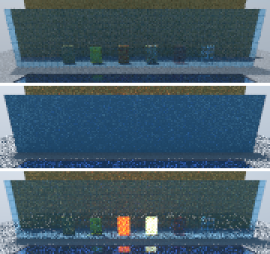
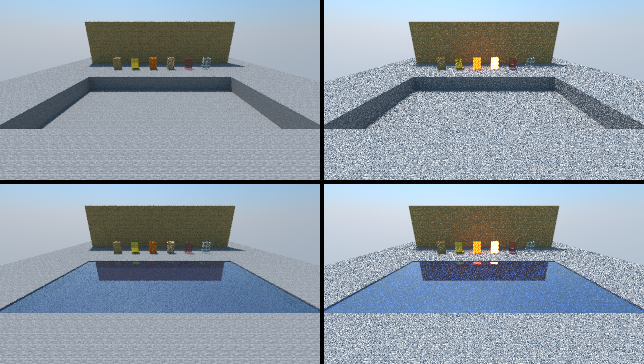

# OpenCL Plugin (personal fork)

> **About this fork:** I made these changes for my own renders. If they look useful to you, feel free to use them too :)
> The work was done with the help of Claude (an AI assistant) and checked by rendering the same scenes with
> Chunky's CPU path tracer and comparing the results. Based on upstream commit `d5621bc`.

### What's changed

- **Headless renders no longer come out black.** The render loop counted GPU passes as samples before they
  were merged into the sample buffer, so a `chunky -render` with fewer than 1024 spp could finish with an
  empty image. `scene.spp` now only advances after a merge, and the last pass is always merged.
- **Water is rendered.** The water octree is now uploaded to the GPU, with partial water surfaces, Fresnel
  reflection and refraction (IOR 1.333), water fog (visibility), water opacity and custom water color,
  following Chunky's `PathTracer`.
- **Translucent blocks are see-through.** Stained glass and stained glass panes used to render as solid
  colored walls because every pixel of their texture is partially transparent. Translucency, Fresnel
  reflection and refraction now follow the CPU renderer (including fancier translucency and the
  transmissivity cap).
- **Large merged areas of non-full blocks** (e.g. lake surfaces) no longer get holes.
- **Sun sampling (next event estimation).** With the default "Fast" sun sampling strategy, diffuse
  surfaces now sample the sun directly with a shadow ray (through glass and water), like the CPU renderer.
  On my glass building scene this reaches the same noise level about 2-2.7x faster.
- **Russian roulette.** Paths that carry little light end early (unbiased). About 1.7x faster to the same
  noise level on the same scene; the mean brightness is unchanged (checked against a 4000 spp reference).
- **Less CPU work while rendering:** buffer merges and post processing run at most 4 times per second while
  the canvas is visible (about 1.5x more spp/s at 1080p in my test).
- **JOCL updated to 2.0.6**, which includes an arm64 (Apple Silicon) macOS library. Not tested on a Mac yet.
- **Builds with current tooling:** Gradle 8.10, Java 17. Build against a local Chunky checkout with
  `./gradlew jar -PchunkyDir=../chunky` (the published `2.5.0-SNAPSHOT` is from March 2024).
- Small fixes: a stray `jdk.jpackage.internal.Log` import, OpenCL events that were never released,
  resumed renders repeating the same random samples.

| Stained glass: CPU / GPU before / GPU after | Water: CPU (left) vs GPU (right), without / with water |
|---|---|
|  |  |

### Still different from the CPU renderer

No fog, no water wave shading, emitter intensity is fixed (emitters look brighter), HDR skies above 1.0 are
clipped, the "Importance" sun sampling strategy behaves like "Off", and large worlds that Chunky stores in the
NODE octree format are not supported.

---

This is a plugin for [Chunky](https://github.com/chunky-dev/chunky) which harnesses the power of the GPU with OpenCL 1.2+ to accelerate rendering.

#### This is currently a work in progress and does not support many features. The core renderer itself is still under development so render results may change drastically between versions.

## Installation

### Note: This requires the `2.5.0` snapshots.
Download the [latest plugin release](https://github.com/chunky-dev/chunky-opencl/releases) and extract it. In the Chunky Launcher, expand `Advanced Settings` and click on `Manage plugins`. In the `Plugin Manager` window click on `Add` and select the `.jar` file in the extracted zip file. Click on `Save` and start Chunky as usual.

Select `ChunkyCL` as your renderer for the scene in the `Advanced` tab.

## Performance

Rough performance with a RTX 2070 is around 400 times that of the traditional CPU renderer as of 2022-01-27.

Some settings have been added to improve render performance.
* Indoor scenes should disable sunlight under `Lighting`
* Draw depth may be adjusted under `Advanced`
* Draw entities may be unchecked under `Advanced`
* OpenCL Device selector under `Advanced`

## Compatibility

* Not compatible with the Denoising Plugin.

---

## Development
This project is setup to work with IntelliJ and CLion. The base directory is intended to be opened in IntelliJ and the `src/main/opencl` directory in CLion.

For hot reloading, add `-DchunkyClHotReload="<src/main/opencl directory>"` as a JVM option.

## Copyright & License
ChunkyCL is Copyright (c) 2021 - 2024, [ThatRedox](https://github.com/ThatRedox) and contributors.

Permission to modify and redistribute is granted under the terms of the GPLv3 license. See the file `LICENSE` for the full license.

ChunkyCL uses the following 3rd party libraries:
* [Chunky](https://github.com/chunky-dev/chunky/)
* [JOCL](http://www.jocl.org/) (MIT, see `licenses/jocl.txt`)
* [OpenCL header from the LLVM Project](https://llvm.org)
